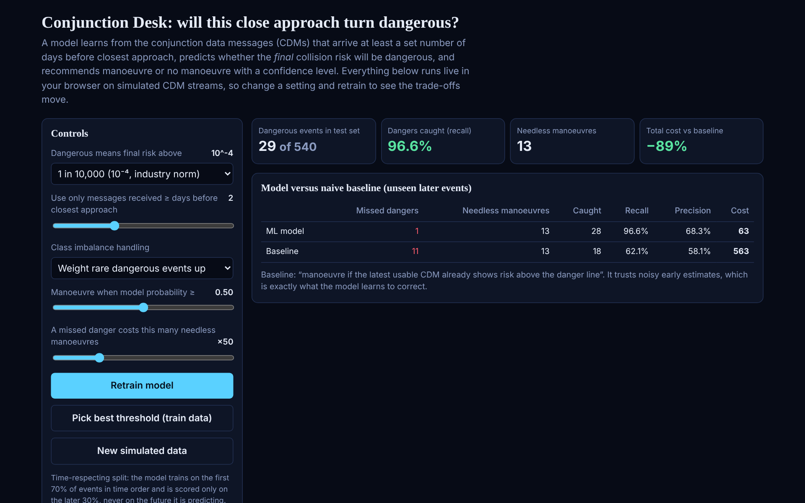
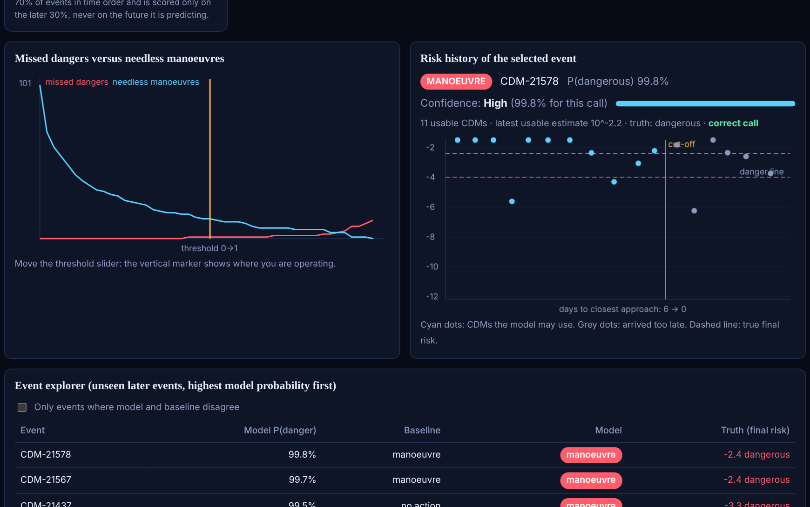

# Satellite Collision Risk Predictor (SW-5)

**StarForge Hackathon | Dark Side - Software Track | Problem SW-5**
Team **Hackathonnew23** | Team leader: **Jeevan.M.Gowda**

An interactive web app that predicts whether a satellite close approach will turn dangerous and recommends **manoeuvre / no manoeuvre** with a confidence level, using only conjunction data messages (CDMs) received **at least 2 days before** closest approach.

## The problem
Satellites and debris move at several km/s, so a collision can destroy a satellite. Operators receive CDMs whose risk estimates are updated every few hours and must decide days ahead whether to manoeuvre. Most warnings are harmless, so dangerous events are rare and easy to miss.

## What it does
- Builds features from each event's CDM history (latest, max and mean risk, trend, miss distance, covariance, relative speed, message count)
- Enforces a configurable cut-off (1 to 4 days, default 2): no future data is used
- Time-respecting split: trains on the earliest 70% of events, tests on the later 30%
- Handles class imbalance with class weighting (toggle on/off to compare)
- Compares against a simple baseline: "manoeuvre if the latest CDM is above the danger line"
- Reports **missed dangerous events vs unnecessary manoeuvres**, recall, precision and a cost metric
- Cost slider and "pick best threshold" (tuned on training data only)
- Event explorer with per-event risk history, recommendation and confidence (High / Medium / Low)

## Results (default simulated data, seed 7, danger line 10^-4, 2-day cut-off)
| Method | Missed dangers | Needless manoeuvres | Cost (miss = 50x) |
|---|---|---|---|
| Baseline rule | 11 | 13 | 563 |
| ML, no class weighting | 11 | 1 | 551 |
| ML, weighted + tuned threshold | 1 | 8 | 58 |

Test set: 540 events, 29 dangerous. Data is **simulated**; validate on real data before any operational use.

## Run it
No build step and no dependencies. Open `index.html` in a browser.

To host on GitHub Pages: **Settings > Pages > Deploy from branch > main / (root)**.

## Tech
HTML5, CSS3, vanilla JavaScript, Canvas 2D. Logistic regression (gradient descent, L2, z-score scaling, class weights) implemented from scratch.

## Roadmap
- Load the real ESA Kelvins Collision Avoidance dataset
- Gradient boosting with calibration (Brier score)
- Sequence models over the CDM series
- Live CDM feed and alerting

## References
- ESA Kelvins Collision Avoidance Challenge: https://kelvins.esa.int/collision-avoidance-challenge/
- Uriot, Izzo et al., Spacecraft collision avoidance challenge: design and results of a machine learning competition, Astrodynamics 6(2), 2022: https://doi.org/10.1007/s42064-021-0101-5
- Dataset (Zenodo): https://zenodo.org/records/4463683

## Presentation
See `docs/StarForge_SW-5_Collision_Risk.pptx`.

## License
MIT
